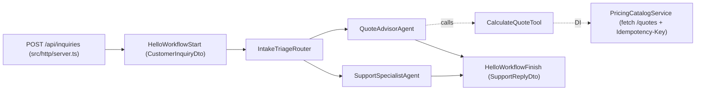

# `01-hello-agboss` — First-Run, Real HTTP Service DI, Web Server & CLI Scaffolding Proof

## 1. What problem this example addresses

When evaluating an agentic framework, three questions come up on day one:
1. **Packaging & CLI parity:** Do distributed npm tarballs (`@agboss/core` and `@agboss/cli`) include all compiled declarations, CLI generators (`agboss create`, `agboss generate`), templates, and the 13 coding-agent skills?
2. **Real async DI & HTTP services:** How does an `@Injectable` service (`PricingCatalogService`) read URLs and secrets from `ApplicationContext.environment`, verify endpoint health in `async onInit()`, and pass `ExecutionContext.signal` + `ExecutionContext.step.idempotencyKey` to `fetch(...)` — while remaining trivially mockable in workflow/tool unit tests via `mockOf(PricingCatalogService)`?
3. **Production HTTP backend integration:** How is an AGBoss application mounted into an HTTP server (`src/http/server.ts`) with multi-tenant headers (`x-tenant-id`, `x-user-id`, `x-thread-id`), `202 Accepted` on pauses, `/api/pauses/:pauseId/resume`, `/api/threads/:threadId/cancel`, and `/health/live` + `/health/ready` probes?

## 2. Canonical Project Layout (`1 class = 1 file`, Spring-style symmetric `tests/`)

```text
src/
  ├── hello-agboss.application.ts
  ├── demo.ts
  ├── http/
  │   └── server.ts
  ├── contexts/
  │   ├── hello-tenant.context.ts
  │   └── hello-execution.context.ts
  ├── environments/
  │   ├── app.environment.ts
  │   ├── dev.environment.ts
  │   └── test.environment.ts
  ├── dto/
  │   ├── customer-inquiry.dto.ts
  │   ├── quote-calculation-input.dto.ts
  │   ├── quote-calculation-output.dto.ts
  │   └── support-reply.dto.ts
  ├── workflows/
  │   └── hello-agboss/
  │       ├── hello-agboss.workflow.ts
  │       ├── hello.workflow-start.ts
  │       └── hello.workflow-finish.ts
  ├── agents/
  │   ├── quote-advisor/
  │   │   ├── quote-advisor.agent.ts
  │   │   └── quote-advisor.prompt.md
  │   └── support-specialist/
  │       ├── support-specialist.agent.ts
  │       └── support-specialist.prompt.md
  ├── routers/
  │   └── intake-triage/
  │       ├── intake-triage.router.ts
  │       └── intake-triage.prompt.md
  ├── tools/
  │   └── calculate-quote.tool.ts
  ├── services/
  │   └── pricing-catalog.service.ts
  ├── budgets/
  │   ├── hello-application-daily.budget.ts
  │   ├── hello-tenant-daily.budget.ts
  │   └── hello-execution.budget.ts
  └── model-providers/
      └── openrouter-chat.model-provider.ts

tests/
  ├── services/
  │   └── pricing-catalog.service.test.ts
  ├── tools/
  │   └── calculate-quote.tool.test.ts
  ├── http/
  │   └── server.test.ts
  └── workflows/
      └── hello-agboss/
          └── hello-agboss.workflow.test.ts
```

## 3. Architecture diagram



## 4. Quick start commands

```bash
npm install
npm run check
npm test
npm run demo
```
