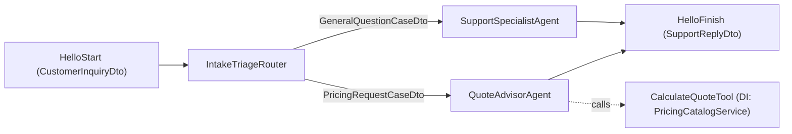

# `hello-agboss` — First-Run & Packaging Smoke Proof

## 1. What problem this example addresses

When evaluating an agentic framework, two failures commonly block adoption on day one:
1. Packaging drift — distributed npm tarballs omit compiled declarations, CLI binaries, templates, or agent skills that existed in the monorepo.
2. Unverified runtime wiring — dependency injection, router branching, tool execution, and typed DTO assembly fail when imported strictly via public package entrypoints (`agboss`, `agboss/dto`, `agboss/testing`).

## 2. Why naive implementations fail

Naive examples either import directly from monorepo source paths (`../../packages/agboss/src`) or only print a console string without asserting typed workflow routing, DI resolution, static analyzer output (`.agboss/types.d.ts`), and clean `agboss create` project generation.

## 3. How AGBoss models and solves it

`hello-agboss` is a standalone consumer package that imports exclusively from the public `agboss` and `agboss-cli` packages:
- **`@Application` (`HelloAgbossApplication`)** wires workflows, agents, routers, tools, injectable services, and model providers.
- **`@Workflow` (`HelloAgbossWorkflow`)** defines a typed path from `HelloStart` through `IntakeTriageRouter` to either `SupportSpecialistAgent` (`GeneralQuestionCaseDto`) or `QuoteAdvisorAgent` (`PricingRequestCaseDto`, equipped with `CalculateQuoteTool`), converging on `HelloFinish`.
- **`@Injectable` (`PricingCatalogService`)** is injected via constructor DI into `CalculateQuoteTool`.
- **`agboss check`** generates `.agboss/types.d.ts` and `.agboss/execution.d.ts`, validates the flow graph, and syncs the 13 framework skills into `.claude/skills/agboss/`.

## 4. Architecture diagram



## 5. Quick start commands

```bash
npm install
npm run check
npm test
npm run demo
```

## 6. Offline deterministic mode

All three primary commands (`npm run check`, `npm test`, `npm run demo`) run completely offline with zero external API keys:
- `npm test` uses `testWith(HelloAgbossApplication)` (`agboss/testing`) and runs an isolated `agboss create` smoke test in a temporary directory.
- `npm run demo` boots `createApp(HelloAgbossApplication)` with an offline deterministic `@ModelProvider` transport and executes both workflow branches end-to-end.

## 7. Optional live-model mode

Set `OPENROUTER_API_KEY` in `.env` (copied from `.env.example`) to run against a live model provider via `OpenRouterModelProvider`.

## 8. Failure scenarios and how to run them

- **Static contract check:** `npm run check` (runs `agboss check && tsc --noEmit && eslint`).
- **Component & routing test suite:** `npx vitest run tests/smoke.test.ts`
- **Isolated `agboss create` CLI scaffold proof:** `npx vitest run tests/create-project.test.ts`

## 9. Expected proof output

- `npm run check` exits `0` and generates `.agboss/types.d.ts`, `.agboss/execution.d.ts`, and `.claude/skills/agboss/references/01..13`.
- `npm test` passes both `tests/smoke.test.ts` and `tests/create-project.test.ts`.
- `npm run demo` executes both `GeneralQuestionCaseDto` and `PricingRequestCaseDto` paths and prints verified JSON execution summaries.

## 10. Guarantee boundary (what remains the user's responsibility)

AGBoss guarantees compile-time & static-analysis verification of workflow wiring, DTO path availability, constructor DI resolution, and deterministic test execution. Business pricing rules inside `PricingCatalogService` and prompt quality inside `*.prompt.md` remain the application's responsibility.
