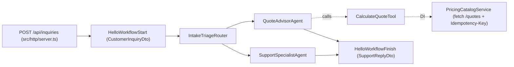

# `01-hello-agboss` — First-Run, Real HTTP Service DI, Web Server & CLI Scaffolding Proof

## 1. What problem this example addresses

When evaluating an agentic framework, three questions come up on day one:
1. **Packaging & CLI parity:** Do distributed npm tarballs (`@agboss/core` and `@agboss/cli`) include all compiled declarations, CLI generators (`agboss create`, `agboss generate`), templates, and the 13 coding-agent skills?
2. **Real async DI & HTTP services:** How does an `@Injectable` service (`PricingCatalogService`) read URLs and secrets from `ApplicationContext.environment`, verify endpoint health in `async onInit()`, and pass `ExecutionContext.signal` + `ExecutionContext.step.idempotencyKey` to `fetch(...)` — while remaining trivially mockable in workflow/tool unit tests via `mockService(PricingCatalogService)`?
3. **Production HTTP backend integration:** How is an AGBoss application mounted into an HTTP server (`src/http/server.ts`) with multi-tenant headers (`x-tenant-id`, `x-user-id`, `x-thread-id`), `202 Accepted` on pauses, `/api/pauses/:pauseId/resume`, `/api/threads/:threadId/cancel`, and `/health/live` + `/health/ready` probes?

## 2. Canonical Project Layout (`1 class = 1 file`, Spring-style symmetric `tests/`)

```text
src/
  ├── hello-agboss.application.ts
  ├── scripts/                 # run when imported, never loaded by `agboss check`
  │   ├── demo.ts, demo.stream.ts, demo.cli.ts
  │   ├── hello-agboss.gateway.app.ts, hello-agboss.<vendor>-cli.app.ts
  │   └── environments/        # the second applications' environments (re-exports)
  ├── http/
  │   └── server.ts
  ├── contexts/
  │   ├── hello-tenant.context.ts
  │   └── hello-execution.context.ts
  ├── environments/
  │   ├── app.environment.ts
  │   ├── dev.environment.ts
  │   └── test.environment.ts
  ├── dto/
  │   ├── customer-inquiry.dto.ts
  │   ├── quote-calculation-input.dto.ts
  │   ├── quote-calculation-output.dto.ts
  │   └── support-reply.dto.ts
  ├── workflows/
  │   └── hello-agboss/
  │       ├── hello-agboss.workflow.ts
  │       ├── hello.workflow-start.ts
  │       └── hello.workflow-finish.ts
  ├── agents/
  │   ├── quote-advisor/
  │   │   ├── quote-advisor.agent.ts
  │   │   └── quote-advisor.prompt.md
  │   └── support-specialist/
  │       ├── support-specialist.agent.ts
  │       └── support-specialist.prompt.md
  ├── routers/
  │   └── intake-triage/
  │       ├── intake-triage.router.ts
  │       └── intake-triage.prompt.md
  ├── tools/
  │   └── calculate-quote.tool.ts
  ├── services/
  │   └── pricing-catalog.service.ts
  ├── budgets/
  │   ├── hello-application-daily.budget.ts
  │   ├── hello-tenant-daily.budget.ts
  │   └── hello-execution.budget.ts
  ├── storages/
  │   └── hello.database-storage.ts      # @DatabaseStorage on SqliteDriver, the PII key via defineEnv
  └── model-providers/
      └── openrouter-chat.model-provider.ts   # a driver provider: OpenRouterDriver, key and URL as references

tests/
  ├── services/
  │   └── pricing-catalog.service.test.ts
  ├── tools/
  │   └── calculate-quote.tool.test.ts
  ├── http/
  │   └── server.test.ts
  └── workflows/
      └── hello-agboss/
          └── hello-agboss.workflow.test.ts
```

## 3. Architecture diagram



## 4. Quick start commands

```bash
npm install
npm run check
npm test
npm run demo
```

### Try it on your own subscription (demo / local only)

The same workflow can run on a vendor's own CLI, under your own login, with no API key. It plugs in
through the public transport contract (`@ModelProvider` with `complete(request)`); core is not touched
and `npm run check` / `npm test` / `npm run demo` stay offline.

```bash
npm run demo:codex-cli     # codex exec on a ChatGPT plan (OpenAI documents this use)
npm run demo:claude-cli    # claude -p      (Anthropic's terms prohibit this for third-party products)
npm run demo:gemini-cli    # gemini -p      (Google's Gemini CLI terms prohibit this for third-party tools)
```

Each provider logs a startup warning that quotes the vendor's terms: agboss does not and cannot
guarantee compliance, the account risk is yours. The Claude and Gemini providers exist only behind
`acknowledgeVendorTermsRisk: true`. The code is in `src/cli-providers/` (one runner: a fresh temp cwd,
an environment allowlist with no keys, the CLI's own tools off, one process at a time, the process
tree killed on abort); the credential files of the vendors are never read. The Claude and Gemini
fixtures in `tests/cli-providers/fixtures/` are written from the vendors' docs, not recorded.
Full guide: the Wiki page "Try agboss on a subscription".

## 5. Streaming the answer (#1005, #1011)

A support chat widget wants the reply token by token, not after the last token. `StreamingAnswerWorkflow`
(`src/workflows/streaming-answer/`) has one plain-text agent, `AnswerWriterAgent`: no `output` DTO, so
its answer streams to `onStream` as `StreamEventKind.TextDelta` events (an agent with an output DTO answers through a
tool call and streams no text, #1004). Two providers stream it:

- `OpenRouterChatModelProvider`, a driver provider (`OpenRouterDriver`: HTTP, server-sent events), the explicit `modelProvider` of `HelloAgbossApplication`;
- `GatewayStreamModelProvider` (`src/model-providers/gateway-stream.model-provider.ts`), a transport
  provider for a company LLM gateway that is no OpenAI-compatible server: it implements `complete()` and
  `stream()` and is listed in `HelloAgbossGatewayApplication` (`src/scripts/hello-agboss.gateway.app.ts`).

| What it proves | Test |
| --- | --- |
| a transport's `stream()` chunks are text deltas, heard before the answer is complete (the stub holds the rest until the widget has the first token) | `tests/model-providers/gateway-stream.model-provider.test.ts` |
| the usage a transport reports is counted once, tokens times the price table | same |
| a transport failure before the first chunk is retried; one after the first chunk is not (the text is out) | same |
| an HTTP provider streams token by token from a server-sent stream on 127.0.0.1, heard before the answer is complete | `tests/model-providers/openrouter-chat.model-provider.test.ts` |
| the call is `stream: true` with `include_usage`, and the cost of the usage chunk is the call's cost; a run without `onStream` is a plain call | same |
| a cut stream (before or after the first token) or one that ends without `[DONE]` is a failed attempt, never a short answer, and a stream that already showed text is not retried | same |

All of it runs against stubs on `127.0.0.1`: `npm test` needs no key and no network. A live look (needs
`OPENROUTER_API_KEY`, skips with a message without it):

```bash
npm run demo:stream   # the reply streams from OpenRouter; prints the deltas count, first/last arrival, spend
```

## 6. The 0.1.1 shape of this example

- Prompts are `PromptSource`s (`prompt: "./quote-advisor.prompt.md"`), every `@Workflow` has `historyTtl`, flows are
  written with `onStart(...)`, `.toRouter(...)` and one `.onRoute(...)` per router route, and a `@Tool` has `execute`.
- The model provider is explicit: `OpenRouterChatModelProvider` is listed in `providers` and named as the application's
  `modelProvider`; its `OpenRouterDriver` reads `secret("OPENROUTER_API_KEY")` and `env("OPENROUTER_BASE_URL")` when the
  application starts, so neither is a field of the environment contract.
- The rows go to `HelloDatabaseStorage` (`@DatabaseStorage`, `SqliteDriver`); its PII key is read through `defineEnv`.
- `agboss check` loads every module under `src/` except `scripts/` and `bin/`, so the demos and the three CLI / gateway
  applications live in `src/scripts/`: a workflow that two applications list keeps its typed contexts.
- The tests use `testUnit(CalculateQuoteTool, { services: [...] })` for a tool and `testWith(HelloAgbossApplication)` for the
  application; the model is scripted, so no provider is reached.
