# `path-scope-proof` — Static Dataflow, Freshness & Compensation Proofs

## 1. What problem this example addresses

In graph-based agent frameworks that share a mutable state dictionary across nodes, four structural bug classes routinely pass `tsc --noEmit` and only surface in production:
1. **Missing input on a conditional route (`01-missing-input`)** — one branch skips producing a required field, causing downstream `undefined` crashes or silent corruption.
2. **Stale data after a revision cycle (`02-outdated-data`)** — an upstream artifact is revised in a loop, but downstream nodes read a sign-off computed from an earlier version.
3. **Parallel sibling invalidation (`03-parallel-invalidation`)** — one parallel branch rewrites a shared artifact while its sibling concurrently audits the pre-launch version.
4. **Uncompensated side-effect on an error path (`04-uncompensated-action`)** — an `.onError(...)` side path reaches a workflow finish without undoing a prior reversible `@Action`.

## 2. Why naive implementations fail

Conventional `StateGraph` / `Annotation.Root` architectures type every channel field as optional or defaulted (`field: Annotation<T | undefined>`) because not all fields exist at workflow start. Consequently, TypeScript cannot prove which fields have been populated or invalidated along a specific control-flow path.

## 3. How AGBoss models and solves it

AGBoss replaces untyped state bags with **Path Scope Dataflow Analysis** (`agboss check`):
- Components declare typed DTO inputs and outputs (`@Agent`, `@Action`, `@Router`, `@WorkflowStart`, `@WorkflowFinish`).
- `agboss check` walks all reachable abstract scopes across branches, loops, parallel joins, and `.onError` paths before execution.
- It emits deterministic diagnostic codes (`[input.missing-on-path]`, `[input.outdated-on-path]`, `[launch.branch-outdates-sibling]`, `[flow.uncompensated-action]`) with witness paths and generates `.agboss/types.d.ts` so `tsc --noEmit` also enforces component contracts.

## 4. Architecture diagram

```mermaid
flowchart TD
    subgraph Case01["01: [input.missing-on-path]"]
        S1["Start"] --> R1["Router"]
        R1 -- "reviewed" --> C1["ComplianceReview (ComplianceApprovalDto)"] --> P1["PublishContract"]
        R1 -- "fast-track (missing approval!)" --> P1
    end
    subgraph Case02["02: [input.outdated-on-path]"]
        W2["DraftWriter"] --> L2["LegalCheck (LegalSignoffDto)"] --> Q2["QualityReviewer"]
        Q2 -- "RevisionRequested (about: ContractDraftDto)" --> RW2["RevisionWriter (replaces ContractDraftDto)"]
        RW2 -- "skips LegalCheck!" --> F2["FinalizeContract (reads stale LegalSignoffDto)"]
    end
    subgraph Case03["03: [launch.branch-outdates-sibling]"]
        S3["QuoteBuilder (QuoteSheetDto)"] --> P3["Parallel Launch"]
        P3 --> B3A["PricingRewriter (replaces QuoteSheetDto)"]
        P3 --> B3B["TaxAudit (reads QuoteSheetDto -> TaxAuditReportDto)"]
        B3A --> J3["Join (TaxAuditReportDto already outdated!)"]
        B3B --> J3
    end
    subgraph Case04["04: [flow.uncompensated-action]"]
        A4["ReserveInventory (compensateWith: ReleaseInventory)"] --> C4["ChargeCard (throws)"]
        C4 -- ".onError (skips ReleaseInventory!)" --> E4["OrderFailedFinish"]
    end
```



## 5. Quick start commands

```bash
npm install
npm run check
npm test
npm run demo
```

## 6. Offline deterministic mode

All checks, tests, and demos execute 100% offline with zero external API keys.

## 7. Optional live-model mode

Not required — `path-scope-proof` proves static analyzer guarantees and deterministic runtime behavior.

## 8. Failure scenarios and how to run them

- `npm test` runs `tests/diagnostics.test.ts` across all 4 cases:
  1. Verifies that `langgraph-broken/graph.ts` compiles cleanly with `tsc --noEmit` yet fails or silently corrupts state at runtime.
  2. Verifies that `agboss check --json` rejects `agboss-broken/application.ts` with the exact expected rule code and witness path in `expected.json`.
  3. Verifies that `agboss check` and `tsc --noEmit` accept `agboss-fixed/application.ts` and that the fixed workflow executes cleanly at runtime.
- `npm run demo` prints a side-by-side comparison table of all 4 cases.

## 9. Expected proof output

- `01-missing-input`: `[input.missing-on-path]` on `publish-contract-action.approval`
- `02-outdated-data`: `[input.outdated-on-path]` on `finalize-contract-action.legal`
- `03-parallel-invalidation`: `[launch.branch-outdates-sibling]` on `pricing-rewriter-agent`, `tax-audit-agent`
- `04-uncompensated-action`: `[flow.uncompensated-action]` on `reserve-inventory-action`

## 10. Guarantee boundary (what remains the user's responsibility)

AGBoss statically guarantees DTO presence, freshness across `about` / `builtFrom` provenance chains, parallel join non-interference, and compensation coverage on error paths. Domain logic inside individual `@Action` handlers and accurate `{ about: TargetDto }` declarations remain the developer's responsibility.
